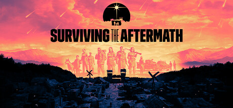

**Surviving the Aftermath is the post-apocalyptic colony builder where your survivors must establish a settlement while managing specialists sent to explore a dangerous outside world, gather resources, and negotiate with rival colonies.**

---

## 📖 About

Surviving the Aftermath is the post-apocalyptic colony builder where your survivors must establish a settlement while managing specialists sent to explore a dangerous outside world, gather resources, and negotiate with rival colonies.

## ⚠️ Problems Without Trainer

| Problem | Status |
|---------|--------|
| **Specialist Deaths** — Losing key specialists in world exploration creates severe skill gaps | ✅ Solved |
| **Disaster Preparation** — Radioactive storms and earthquakes require redundant system backups | ✅ Solved |
| **Colony Morale** — Population happiness requires balancing all basic needs simultaneously | ✅ Solved |
| **Research Pace** — Unlocking critical technologies requires sustained research investment | ✅ Solved |

## ✅ Solution

The **Surviving the Aftermath Trainer** solves all these issues by giving you complete control over the game.

## 🎯 Full Feature List

- Unlimited Resources
- God Mode / Invincibility
- Instant Skill Cooldown
- One-Hit Kill
- Freeze Game Timer
- Unlock All Items & Achievements
- Custom Speed Multiplier
- Save State Anywhere

## 🚀 Quick Start

1. **Disable Windows Defender** temporarily (trainer may trigger false positive)
2. Download the trainer from the button above
3. Launch Surviving the Aftermath
4. Run the trainer as Administrator
5. Activate desired cheats with hotkeys

## 💎 Free vs Paid

| Feature | Free | Pro |
|---------|------|-----|
| Basic God Mode | ✅ | ✅ |
| Unlimited Resources | ✅ | ✅ |
| All Advanced Cheats | ❌ | ✅ |
| Auto-Updates | ❌ | ✅ |
| Priority Support | ❌ | ✅ |

## 💻 Requirements

- Windows 10/11 (64-bit)
- Surviving the Aftermath (any version)
- .NET Framework 4.8+
- DirectX 11+

## 🍎 macOS

macOS users can use our alternative tool:

## ⚖️ Legal

This trainer is for educational and single-player use only. Use responsibly.

---

